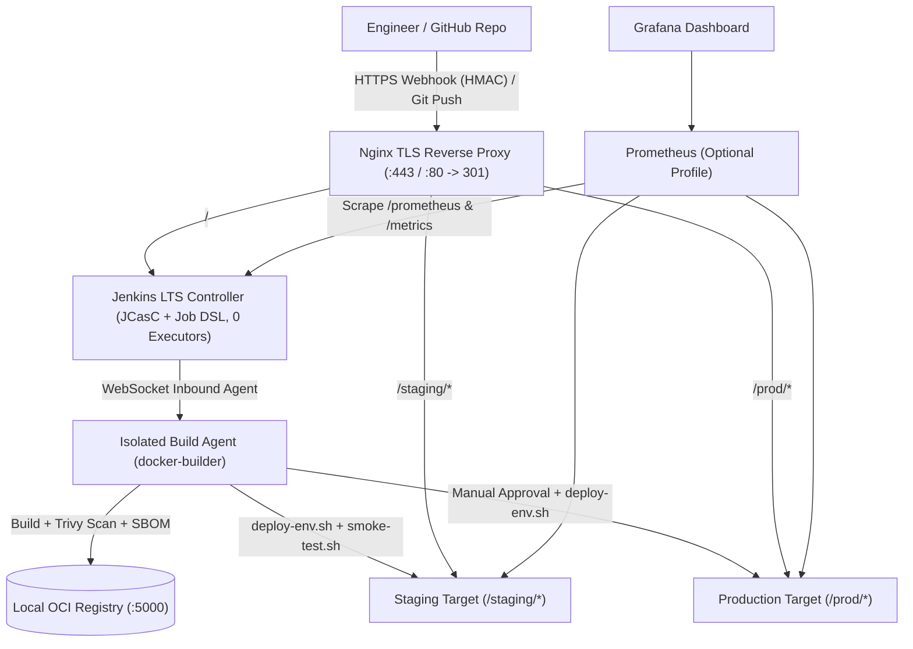
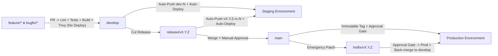
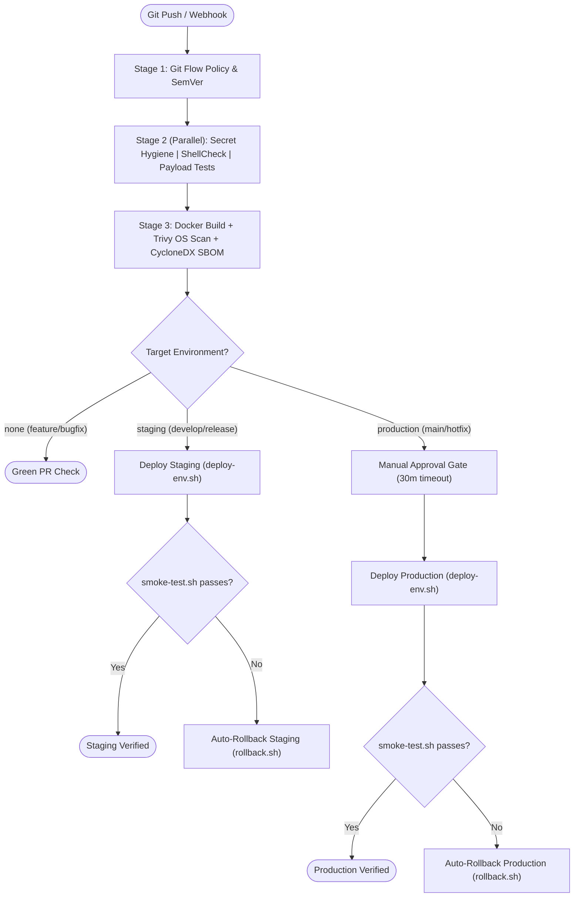

# jenkins-gitflow-platform — JCasC & Enterprise Git Flow CI/CD Platform

A production-grade, reproducible **Jenkins-as-Code (JCasC)** and **Git Flow CI/CD Platform** built with **Jenkins LTS (`2.479.3`)**, **Job DSL Multibranch Pipelines**, a unit-tested **Groovy Shared Library**, isolated **Docker Build Agents** (`numExecutors: 0` on controller), **Nginx TLS**, local **OCI Registry**, **Trivy + CycloneDX SBOM** supply-chain gates, **Prometheus/Grafana** observability, automated **Staging/Production** rollouts with **1-command rollback**, and **Jenkins controller backup/restore**.

---

## System Architecture



---

## Git Flow Branching & Promotion Model



### Branch-to-Stage Execution Matrix

| Branch Pattern | Policy Valid | Lint / Security / Tests | Build & Trivy Scan | Registry Push | Target Env | Manual Approval | Auto-Rollback on Smoke Fail |
| --- | --- | --- | --- | --- | --- | --- | --- |
| `feature/*`, `bugfix/*` | Yes | Yes | Yes | No | `none` | No | N/A |
| `develop` | Yes | Yes | Yes | `sha-*`, `dev-<N>` | `staging` | No | Yes |
| `release/vX.Y.Z` | Yes | Yes | Yes | `sha-*`, `vX.Y.Z-rc.<N>` | `staging` | No | Yes |
| `hotfix/vX.Y.Z` | Yes | Yes | Yes | `sha-*`, `vX.Y.Z-hotfix.<N>` | `production` | **Yes (30m timeout)** | Yes |
| `main` | Yes | Yes | Yes | `sha-*`, `prod-<N>` | `production` | **Yes (30m timeout)** | Yes |
| Any other branch | **Rejected** | Skipped (fail-fast) | — | — | — | — | — |

---

## CI/CD Pipeline & Auto-Rollback Flowchart



---

## Pinned Stack Versions

| Component | Pinned Version |
| --- | --- |
| Jenkins LTS Controller | `jenkins/jenkins:lts-jdk21` |
| Jenkins Inbound Agent | `jenkins/inbound-agent:3283.v92c105e0f819-4-alpine-jdk21` |
| OCI Registry | `registry:2.8.3` |
| Reverse Proxy | `nginx:1.27.4-alpine` |
| Verification Payload | `python:3.12.8-slim` (stdlib only, zero third-party runtime CVEs) |
| Observability (optional) | `prom/prometheus:v2.55.1` + `grafana/grafana:11.3.0` |

---

## Quick Start (After Cloning)

### Prerequisites
- **Docker** & **Docker Compose v2**, **OpenSSL** (Git Bash or WSL on Windows for `.sh` scripts)
- *(Optional for local unit tests without Docker)* Python `3.12+` and Java `21` + Gradle `8.10+`

### Step 1 — Clone & Configure Fail-Fast Secrets
```bash
git clone https://github.com/Mahmoud6601/jenkins-gitflow-platform.git
cd jenkins-gitflow-platform
cp .env.example .env
# Edit .env and set strong values for JENKINS_ADMIN_PASSWORD, JENKINS_AGENT_SECRET, GITHUB_WEBHOOK_SECRET
```

### Step 2 — Generate Local TLS Certificates
```bash
./scripts/generate-ssl.sh localhost
```

### Step 3 — Boot the Jenkins-as-Code Stack
```bash
docker compose up -d --build
# Optional: include Prometheus & Grafana CI/CD observability
# docker compose -f docker-compose.yml -f docker-compose.observability.yml up -d --build
```

### Step 4 — Verify Health & Seeded Multibranch Pipeline
```bash
docker compose ps
curl -kfsS https://localhost/healthz
./scripts/smoke-test.sh staging
./scripts/smoke-test.sh production
```
- **Jenkins UI (via Nginx TLS):** https://localhost (pre-configured via `casc.yaml` with `gitflow-ci-cd` Multibranch Pipeline job and `0` controller executors)
- **Staging Probe:** https://localhost/staging/version
- **Production Probe:** https://localhost/prod/version

---

## Running Tests Locally

```bash
# 1. Payload operational probe tests (zero external dependencies)
python -m unittest discover -s payload/tests -v

# 2. Shared Library Git Flow policy unit tests (JUnit 5 + Groovy)
cd shared-library && gradle test --no-daemon && cd ..

# 3. Validate branch naming locally before pushing
./scripts/gitflow-helper.sh validate-branch feature/add-sbom
```

---

## Backup, Restore & 1-Command Rollback

```bash
# Back up Jenkins controller config, jobs & secrets (checksummed tar.gz in gitignored backups/)
./scripts/backup-jenkins.sh

# Restore Jenkins controller from a verified archive
./scripts/restore-jenkins.sh backups/jenkins-home-YYYYMMDD-HHMMSSZ.tar.gz

# Instant 1-command rollback of staging or production to previous immutable tag
./scripts/rollback.sh staging
./scripts/rollback.sh production
```

---

## Troubleshooting

| Symptom | Likely Cause | Fix |
| --- | --- | --- |
| Compose fails immediately with `Set JENKINS_ADMIN_PASSWORD` | Missing `.env` secret (fail-fast guard) | Copy `.env.example` to `.env` and populate all secrets |
| Jenkins builds stay pending in queue | `numExecutors: 0` on controller by design; agent not connected | Connect `docker-builder` inbound agent using secret from Jenkins node config |
| Pipeline fails in Stage 1 (`violates Git Flow naming policy`) | Branch name does not match Git Flow rules | Use `./scripts/gitflow-helper.sh start-feature <slug>` or `docs/GITFLOW-POLICY.md` |
| Smoke test fails after deploy | Target container failed `/healthz` or `/version` SHA mismatch | `deployAndVerify` automatically executes `scripts/rollback.sh`; inspect `docker compose logs` |

---

## Repository Structure

```text
.
├── .github/workflows/ci.yml        # Meta-CI: secrets, ShellCheck, Hadolint, Groovy lint, Gradle, Trivy & Compose E2E
├── Jenkinsfile                     # Declarative Git Flow pipeline consuming gitflow-shared-lib
├── jenkins/
│   ├── controller/                 # Pinned LTS Dockerfile, plugins.txt, casc.yaml, Job DSL multibranch_gitflow.groovy
│   └── agent/                      # Isolated docker-builder inbound agent Dockerfile
├── shared-library/                 # Groovy Shared Library (BranchRules.groovy, vars/*.groovy, Gradle JUnit 5 tests)
├── payload/                        # Minimal stateless verification payload (/healthz, /readyz, /version, /metrics)
├── nginx/                          # TLS reverse proxy config for Jenkins + Staging/Prod routes
├── observability/                  # Prometheus scrape config & Grafana datasource provisioning
├── scripts/                        # generate-ssl, deploy-env, rollback, smoke-test, backup/restore-jenkins, gitflow-helper
├── docs/                           # ARCHITECTURE.md, GITFLOW-POLICY.md, DEPLOY.md, RUNBOOK.md
├── docker-compose*.yml             # Base (prod-safe), dev override, and observability profile
└── LICENSE                         # MIT License
```

## Documentation Suite

- [Architecture & Controller Isolation](docs/ARCHITECTURE.md)
- [Git Flow Branching & SemVer Policy](docs/GITFLOW-POLICY.md)
- [Production Deployment & Webhook Security](docs/DEPLOY.md)
- [Operations, Backup & Rollback Runbook](docs/RUNBOOK.md)

## License

Licensed under the **MIT License** — see [`LICENSE`](LICENSE).
